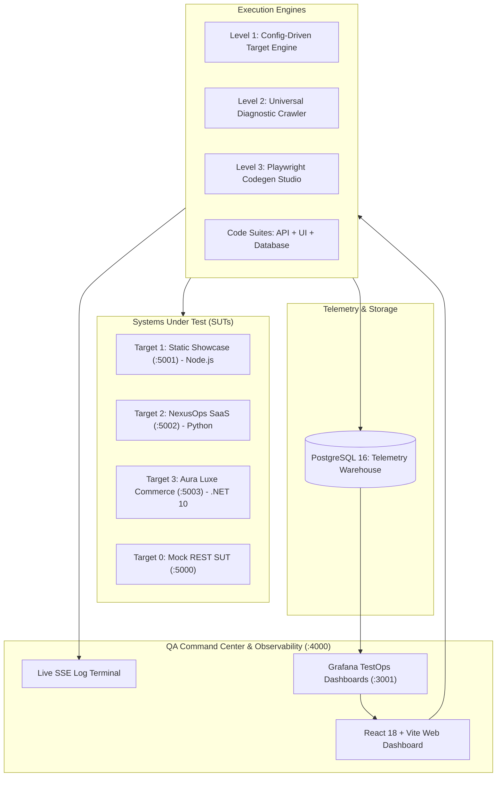

# 🛡️ Enterprise Automated QA & Reliability Testing Platform

[](https://playwright.dev/)
[](https://www.typescriptlang.org/)
[](https://www.postgresql.org/)
[](https://grafana.com/)
[](https://react.dev/)
[](https://www.docker.com/)
[](https://opensource.org/licenses/MIT)

> **A modern, full-stack TestOps and Reliability Engineering platform. It automates testing across UI, REST APIs, and Database Invariants, featuring an interactive React Command Center, deep link auditing, no-code test recording, and live Grafana telemetry.**

---

## 📌 Table of Contents

- [Why This Project Exists](#-why-this-project-exists)
- [Platform Architecture](#-platform-architecture)
- [Core Testing Modes](#-core-testing-modes)
  - [Level 1: Zero-Code Config-Driven Testing](#level-1-zero-code-config-driven-testing)
  - [Level 2: Universal Web Crawler & Broken Link Audit](#level-2-universal-web-crawler--broken-link-audit)
  - [Level 3: Interactive Codegen Test Studio](#level-3-interactive-codegen-test-studio)
  - [Full-Stack Code Suites (UI + API + Database)](#full-stack-code-suites-ui--api--database)
- [Target Applications Tested (SUTs)](#-target-applications-tested-suts)
- [Observability & Dashboard](#-observability--dashboard)
- [Project Directory Structure](#-project-directory-structure)
- [Quickstart Guide](#-quickstart-guide)
- [Available Commands](#-available-commands)
- [Engineering Highlights](#-engineering-highlights-for-interviews)

---

## 💡 Why This Project Exists

In enterprise systems, production bugs rarely happen from simple broken HTML. They happen from **data inconsistency, API contract drifts, and silent database corruption**.

This platform was engineered as an **all-in-one QA automation hub** that:
1. Validates user journeys in the **browser (UI)**.
2. Enforces **REST API contracts and latency SLAs**.
3. Verifies **PostgreSQL relational integrity and financial invariants** at the database level.
4. Provides a **single-pane web dashboard** where any developer, QA engineer, or manager can run tests, record scenarios, audit websites, and view real-time Grafana telemetry without touching the terminal.

---

## 🏛️ Platform Architecture



---

## 🎯 Core Testing Modes

### Level 1: Zero-Code Config-Driven Testing
* **How it works**: Monitors any web application registered in `config/web-targets.json`.
* **What it validates**: Uptime, HTTP status, SSL certificate, page titles, and response latency SLA limits (e.g. `< 1000ms`).
* **Zero code required**: Simply add a URL through the dashboard and click **"Run Config Suite"**.

### Level 2: Universal Web Crawler & Broken Link Audit
* **How it works**: Powered by a headless Chromium engine (`crawlerService.js`).
* **What it validates**: Scans any public or local URL, recursively crawls internal anchor links, discovers broken links (404/500/530 HTTP errors), captures unhandled JavaScript console errors, and takes a visual full-page snapshot.

### Level 3: Interactive Codegen Test Studio
* **How it works**: Integrated browser recorder. Enter a target URL and click **"Launch Recorder"**.
* **What it generates**: As you click buttons and fill out forms, Playwright generates clean, production-ready TypeScript test files into `tests/generated/<name>.spec.ts`.
* **Run Button**: Run individual recorded scenarios directly from the dashboard table with one click!

### Full-Stack Code Suites (UI + API + Database)
* **UI Layer (`tests/ui/`)**: Implements the **Page Object Model (POM)** pattern (`LoginPage`, `InventoryPage`, `CartPage`, `CheckoutPage`) to ensure robust selectors and maintainable test code.
* **API Layer (`tests/api/`)**: Validates REST endpoints, JWT authentication tokens, role-based access control (RBAC), and response time SLAs (< 250ms).
* **Database Invariant Layer (`tests/database/`)**: Queries PostgreSQL directly to assert relational integrity, verify zero orphaned child records, and check financial invariants (e.g., `order_total == SUM(line_item_price * quantity)`).

---

## 🎯 Target Applications Tested (SUTs)

The workspace includes three dedicated, multi-language target applications used to demonstrate real-world testing across different stacks:

| Application | Technology Stack | Port | Tested Capabilities |
| :--- | :--- | :---: | :--- |
| **NovaStack Cloud** | JavaScript, Node.js, HTML5 | `5001` | Broken link crawling, DOM theme toggling, pricing switcher, and form validations. |
| **NexusOps Enterprise** | Python 3.15, Flask, SQLite | `5002` | Role-based JWT auth, incident lifecycle transitions, and SQLite database invariants. |
| **Aura Luxe Commerce** | C# / .NET 10, ASP.NET Core | `5003` | Product catalog filtering, coupon engine, dynamic cart, and full end-to-end checkout. |

---

## 📊 Observability & Dashboard

* **Web Command Center (`http://localhost:4000`)**:
  * Unified control bar to trigger any test suite (`Smoke`, `API`, `Database`, `UI`, `Config`, `All`).
  * Real-time terminal log output streaming via Server-Sent Events (SSE).
  * Interactive failure modal with stack traces and failing step inspection.
* **Grafana TestOps Analytics (`http://localhost:3001`)**:
  * Auto-provisioned dashboards embedded directly into the Command Center.
  * Real-time pass/fail gauges, multi-layer distribution charts, and latency trends stored in PostgreSQL.

---

## 📁 Project Directory Structure

```
qa-reliability-platform/
├── config/                 # Registry for zero-code web targets (web-targets.json)
├── dashboard/              # Full-stack Command Center (Node.js backend + React 18 UI)
│   ├── server.js           # Orchestrator API & real-time SSE log streamer
│   └── client/             # React + Vite + Material UI frontend
├── tests/                  # Automated test suites (57 total tests)
│   ├── api/                # REST API contract & authentication tests
│   ├── config-driven/      # Level 1 automated target health tests
│   ├── crawler/            # Level 2 universal link audit tests
│   ├── database/           # Level 3 PostgreSQL schema & invariant tests
│   ├── generated/          # Tests recorded via Codegen Studio
│   ├── smoke/              # Fast connectivity smoke checks (< 10s)
│   ├── targets/            # Dedicated E2E tests for the 3 target apps
│   └── ui/                 # Browser E2E user journeys using POM
├── pages/                  # Page Object Model classes (LoginPage, InventoryPage, etc.)
├── crawler/                # Deep diagnostic link crawler engine (crawlerService.js)
├── performance/            # SLA latency & concurrency load testing (sla-load.js)
├── fixtures/               # Reusable Playwright contexts & DB client fixtures
├── sql/                    # PostgreSQL initialization schema & seed data
├── sut/                    # Local Docker mock REST service (Port 5000)
├── reports/                # Test outputs, JSON metrics, and JUnit XML
└── docker-compose.yml      # Multi-container orchestration (PostgreSQL + Grafana + SUT)
```

---

## 🚀 Quickstart Guide

### 1. Prerequisites
* [Node.js](https://nodejs.org/) (v20 or higher)
* [Docker Desktop](https://www.docker.com/)

### 2. Install Dependencies
```bash
cd qa-reliability-platform
npm install
```

### 3. Start Infrastructure & Test Targets
```bash
# 1. Start Docker containers (PostgreSQL 5432, Grafana 3001, Target SUT 5000)
npm run docker:up

# 2. (Optional) Start the 3 local target apps (Ports 5001, 5002, 5003)
cd ..
start-all-targets.bat
cd qa-reliability-platform
```

### 4. Launch the Web Dashboard
```bash
npm run dashboard
```
Open **[http://localhost:4000](http://localhost:4000)** in your browser to access the full QA Command Center!

---

## ⚡ Available Commands

| Command | Description |
| :--- | :--- |
| `npm run dashboard` | Launches the QA Web Command Center on port `4000`. |
| `npm run test` | Runs the full automated test suite (57 tests). |
| `npm run test:smoke` | Runs fast connectivity smoke tests. |
| `npm run test:api` | Runs REST API contract and RBAC security tests. |
| `npm run test:db` | Runs PostgreSQL database relational & invariant tests. |
| `npm run test:ui` | Runs browser UI end-to-end tests (Page Object Model). |
| `npm run test:config` | Runs Level 1 zero-code config-driven target tests. |
| `npm run test:crawler`| Runs Level 2 universal broken link & health audit. |
| `npm run test:targets`| Runs dedicated E2E tests for the 3 sample applications. |
| `npm run test:perf` | Runs the 25-worker SLA latency and concurrency benchmark. |
| `npm run docker:up` | Boots PostgreSQL, Grafana, and the Mock REST service. |
| `npm run docker:down`| Safely stops and shuts down all Docker containers. |

---

## 💼 Engineering Highlights (For Interviews)

* **Multi-Layer Reliability**: Automates testing from user clicks (UI) down to database foreign keys and mathematical financial invariants (`total == SUM(price * qty)`).
* **TestOps Observability**: Ingests test run execution telemetry into PostgreSQL and visualizes pass rates and latency regressions via Grafana dashboards.
* **Low-Code to High-Code Spectrum**: Offers zero-code monitoring for business stakeholders, interactive recorder for manual testers, and TypeScript code for automation engineers.
* **Resource Efficient**: Entire Docker stack (PostgreSQL + Grafana + API) is optimized to run smoothly on developer laptops using under **300 MB of RAM**.

---

## 📜 License
This project is open-source and licensed under the [MIT License](LICENSE).
