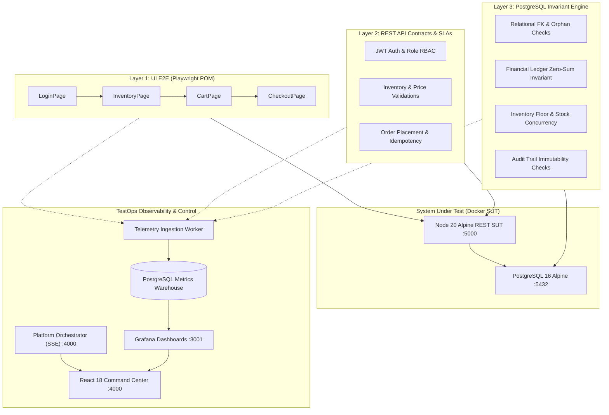

# 🛡️ Enterprise Automated QA & Reliability Testing Platform

[](https://github.com/RohanAshara/qa-reliability-platform)
[](https://playwright.dev/)
[](https://www.typescriptlang.org/)
[](https://www.postgresql.org/)
[](https://grafana.com/)
[](https://react.dev/)
[](https://opensource.org/licenses/MIT)

> **A production-ready, multi-layer TestOps and Reliability Engineering platform designed to automate UI, REST API, and Database Invariant validations with integrated real-time Grafana observability, a React 18 Command Center, and GitHub Actions CI/CD Quality Gates.**

---

## 📑 Table of Contents

- [Overview & Architecture](#-overview--architecture)
- [Key Engineering Highlights](#-key-engineering-highlights)
- [Multi-Layer Testing Strategy](#-multi-layer-testing-strategy)
  - [Layer 1: UI End-to-End Automation (Page Object Model)](#layer-1-ui-end-to-end-automation-page-object-model)
  - [Layer 2: REST API Contract & SLA Validation](#layer-2-rest-api-contract--sla-validation)
  - [Layer 3: Database Invariants & Relational Integrity](#layer-3-database-invariants--relational-integrity)
- [TestOps Observability & Command Center](#-testops-observability--command-center)
  - [PostgreSQL Metrics Warehouse](#postgresql-metrics-warehouse)
  - [Grafana TestOps Dashboards](#grafana-testops-dashboards)
  - [React 18 + TypeScript Visual Command Center](#react-18--typescript-visual-command-center)
- [Performance & SLA Benchmarking](#-performance--sla-benchmarking)
- [CI/CD Multi-Stage Quality Gates](#-cicd-multi-stage-quality-gates)
- [Hardware & Resource Optimization](#-hardware--resource-optimization)
- [Quickstart Guide](#-quickstart-guide)
- [Resume & Portfolio Project Showcase](#-resume--portfolio-project-showcase)

---

## 🏛️ Overview & Architecture

Modern enterprise platforms often fail not in UI rendering or simple HTTP status codes, but in **data consistency, state desynchronization, and silent database corruption**.

This platform was built to bridge the gap between frontend automation, backend API contracts, and persistent relational data integrity. It executes automated tests across three distinct layers, ingests all execution telemetry into a dedicated PostgreSQL metrics warehouse, and visualizes system health through an interactive **React + TypeScript Command Center** and auto-provisioned **Grafana TestOps dashboards**.



---

## ⚡ Key Engineering Highlights

- **48 Automated Tests Passing in ~11.9s**: Comprehensive coverage spanning smoke connectivity, JWT auth, product catalog, checkout journeys, database integrity, and relational constraints.
- **PostgreSQL Invariant Engine**: Direct query-level validation of business invariants, such as ensuring `stock >= 0`, verifying financial ledger totals match line items exactly (`total = SUM(quantity * price)`), and scanning for orphaned child records.
- **Zero-Polling Real-Time Log Streaming**: Platform Orchestrator backend utilizes Server-Sent Events (SSE) to stream test execution output line-by-line to the React frontend.
- **Embedded Grafana TestOps Analytics**: Auto-provisioned Grafana dashboards embedded directly inside the command center via anonymous security tokens, displaying pass-rate donuts, layer breakdowns, and latency percentiles.
- **Ultra-Lightweight Hardware Footprint**: Optimized for modest workstation specifications (e.g., 8GB RAM machines). Total Docker stack (PostgreSQL + SUT API + Grafana) consumes **less than 230 MB of RAM** combined.
- **Deterministic Test Isolation**: Automated UUID-tagged test fixtures and teardown hooks prevent test pollution and eliminate flakiness across concurrent runs.

---

## 🧪 Multi-Layer Testing Strategy

### Layer 1: UI End-to-End Automation (Page Object Model)
Built using **Playwright with TypeScript**, adhering strictly to the **Page Object Model (POM)** pattern to maximize maintainability and reduce selector coupling:
- **`LoginPage`**: Enforces error handling for locked-out accounts, invalid credentials, and blank field validation.
- **`InventoryPage`**: Dynamically sorts products by price/alphabetical order, validates catalog integrity, and asserts badge badge counter synchronization.
- **`CartPage`**: Verifies item retention across navigation, item removal, and subtotal consistency.
- **`CheckoutPage`**: Tests complete end-to-end checkout funnel from user dispatch info to order confirmation.

### Layer 2: REST API Contract & SLA Validation
Powered by a custom **`ApiClient`** abstraction with automatic timing instrumentation:
- **Authentication & RBAC**: Tests valid JWT creation, rejected passwords, expired tokens, role-based admin endpoints, and malformed authorization headers.
- **Product Catalog**: Verifies schema contract conformance, negative pagination boundaries, ID query lookups, and latency SLAs (< 250ms per call).
- **Order Processing**: Validates single-item and multi-item orders, out-of-stock rejection, invalid product ID handling, and authorization guards.

### Layer 3: Database Invariants & Relational Integrity
Interacts directly with the PostgreSQL database using an isolated connection pool (`fixtures/database.ts`):
- **Data Persistence**: Asserts that API-created records commit immediately to PostgreSQL tables with matching column types.
- **Business Invariants**: Validates that no product has a negative price or stock, orders contain valid shipping statuses, and order totals equal the exact sum of line items.
- **Relational Integrity**: Executes cross-table orphan detection queries (`LEFT JOIN ... WHERE parent.id IS NULL`), enforces foreign key cascade behavior, and validates audit trail records.

---

## 📊 TestOps Observability & Command Center

### PostgreSQL Metrics Warehouse
Every test execution persists detailed telemetry into relational schemas:
- `test_runs`: Master run metadata (`run_id`, `suite_name`, `status`, `total_tests`, `duration_ms`, `triggered_by`).
- `test_results`: Granular test data (`test_title`, `file_path`, `layer` [UI/API/Database], `status`, `duration_ms`, `error_message`, `stack_trace`).

### Grafana TestOps Dashboards (`:3001`)
Auto-provisioned via YAML and JSON without manual configuration:
- **Executive KPI Cards**: Total Runs, Overall Pass Rate (%), Total Failures Detected, Average Run Duration.
- **Pass vs Fail Donut Gauge**: Real-time breakdown of test results.
- **Test Distribution by Layer**: Multi-layer distribution bar chart (UI vs. API vs. Database).
- **Duration Trend Over Time**: Historical regression tracking of test execution speeds.
- **Test Runs Audit Table**: Chronological log of recent executions with instant status badges.

### React 18 + TypeScript Visual Command Center (`:4000`)
A modern, dark-mode web application featuring:
- **Interactive Suite Execution**: Launch `All Suites`, `Smoke Suite`, `API Suite`, `Database Suite`, or `UI E2E Suite` directly from the browser.
- **Live Terminal Console**: Streams stdout/stderr from test runners in real-time via Server-Sent Events (SSE).
- **Embedded Grafana Dashboard Tab**: Instant one-click switching between raw test results and high-level visual analytics.
- **Interactive Failure Triaging Modal**: Displays stack traces and failing steps with one-click copy functionality.
- **Database Entity Health Monitor**: Real-time counts of users, products, orders, audit logs, and historical test runs in PostgreSQL.

---

## 🚀 Performance & SLA Benchmarking

The platform includes an automated SLA and concurrency benchmark script (`performance/sla-load.js`) to enforce performance quality gates:

```bash
npm run test:perf
```

### Benchmark Results Under 25 Concurrent Workers:
```text
======================================================================
🚀 ENTERPRISE QA RELIABILITY PLATFORM - SLA PERFORMANCE BENCHMARK
======================================================================
Target SUT Base URL:   http://localhost:5000
Concurrency Limit:    25 concurrent workers
Total Requests:       150 requests across endpoints
P95 Latency SLA Cap:  200 ms
P99 Latency SLA Cap:  350 ms
----------------------------------------------------------------------
Total Requests Completed: 150
Successful Responses:     150 (HTTP 2xx)
Failed Responses:         0 (HTTP non-2xx / network drop)
Error Rate:               0.00%
Total Execution Time:     0.35s
Throughput:               426.1 requests/sec (RPS)
----------------------------------------------------------------------
Min Latency:              11.77 ms
P50 (Median):             23.91 ms
P95:                      185.83 ms (SLA Threshold: < 200 ms)
P99:                      225.23 ms (SLA Threshold: < 350 ms)
======================================================================
✅ SLA QUALITY GATE: PASSED (All latency thresholds met)
======================================================================
```

---

## 🚦 CI/CD Multi-Stage Quality Gates

The pipeline defined in `.github/workflows/quality-gates.yml` enforces four progressive verification gates:

```text
[Push / Pull Request]
         │
         ▼
┌──────────────────────────────────────────────┐
│  Gate 1: Fast Smoke & Connectivity SLA       │  (Fails fast in < 30 seconds if containers or DB are down)
└──────────────────────────────────────────────┘
         │
         ├─────────────────────────────────────┐
         ▼                                     ▼
┌────────────────────────────────┐   ┌────────────────────────────────┐
│  Gate 2: API & Database Invar. │   │  Gate 3: UI E2E User Journeys  │
│  (Contracts, FKs, Ledgers)     │   │  (Playwright POM & Screenshots)│
└────────────────────────────────┘   └────────────────────────────────┘
         │                                     │
         └──────────────────┬──────────────────┘
                            ▼
┌──────────────────────────────────────────────┐
│  Gate 4: Automated Quality Gate Verdict      │  (Publishes HTML Report, enforces 0% failure policy)
└──────────────────────────────────────────────┘
```

---

## 💻 Hardware & Resource Optimization

Designed to run smoothly on developer workstations with limited RAM (e.g., 8 GB):
| Component | Image / Process | Memory Allocation / Footprint |
| :--- | :--- | :--- |
| **Database** | `postgres:16-alpine` | ~45 MB RAM |
| **Target SUT API** | `node:20-alpine` | ~26 MB RAM |
| **Grafana OSS** | `grafana/grafana-oss:11.2.0` | ~156 MB RAM |
| **Platform Server** | `node dashboard/server.js` | ~35 MB RAM |
| **Total Stack** | **Entire TestOps Infrastructure** | **~262 MB RAM Total** |

---

## 🛠️ Quickstart Guide

### 1. Prerequisites
- [Node.js](https://nodejs.org/) (v20+)
- [Docker Desktop](https://www.docker.com/)

### 2. Clone & Install
```bash
git clone https://github.com/RohanAshara/qa-reliability-platform.git
cd qa-reliability-platform
npm install
```

### 3. Start Docker Infrastructure
```bash
# Starts PostgreSQL (5432), Target REST SUT (5000), and Grafana (3001)
npm run docker:up
```

### 4. Run Automated Test Suites
```bash
# Run Fast Smoke connectivity tests
npm run test:smoke

# Run REST API contract & SLA tests
npm run test:api

# Run Database invariant & relational tests
npm run test:db

# Run UI E2E user journeys
npm run test:ui

# Run full multi-layer suite (48 tests)
npm run test:all

# Run Concurrency & SLA Performance benchmark
npm run test:perf
```

### 5. Launch TestOps Command Center
```bash
# Starts Orchestrator server & serves React UI on port 4000
npm run dashboard
```
- Open **http://localhost:4000** in your browser to access the **Visual Command Center**.
- Access the raw **Grafana Dashboard** directly at **http://localhost:3001/d/qa-platform-main**.

---

## 💼 Resume & Portfolio Project Showcase

### Suggested Resume Bullet Points (SDET / QA Platform Engineer)

- **Architected an enterprise multi-layer QA & reliability testing platform** using **Playwright, TypeScript, and PostgreSQL**, executing 48 end-to-end UI, REST API, and database invariant tests in under 12 seconds.
- **Engineered an automated database invariant verification engine** that enforces relational integrity, validates financial ledger balance parity (`total == SUM(line_items)`), and detects orphaned records with sub-15ms SQL validation latency.
- **Implemented a TestOps observability stack** featuring an auto-provisioned **Grafana** dashboard and a **React 18 + TypeScript** command center streaming live runner execution logs via Server-Sent Events (SSE).
- **Designed a 4-stage CI/CD Quality Gate pipeline** with GitHub Actions, incorporating fail-fast connectivity smoke checks, API contract SLAs (< 200ms p95), and automated PR deployment gating.
- **Optimized containerized test infrastructure** to operate at sub-260 MB total RAM utilization across PostgreSQL, REST microservices, and Grafana via Alpine-based lightweight containerization.

---

## 📜 License
Distributed under the MIT License. See `LICENSE` for more information.
